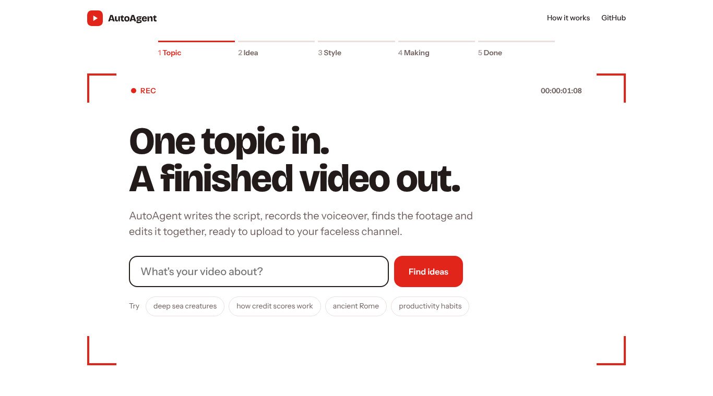
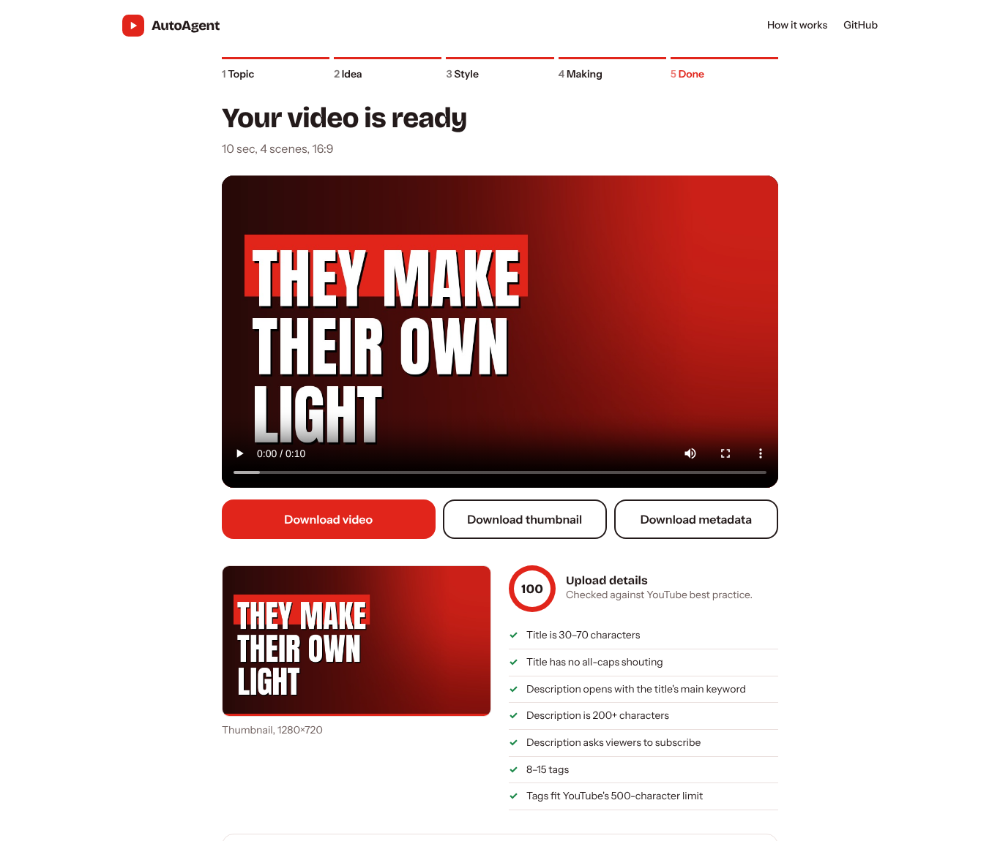
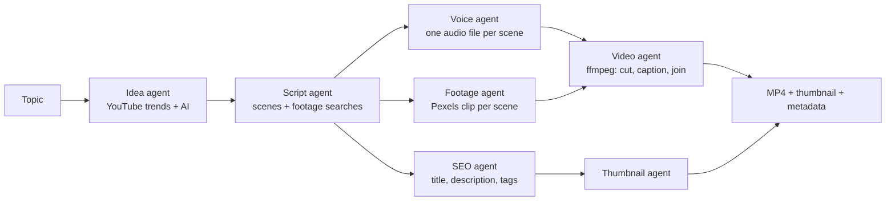
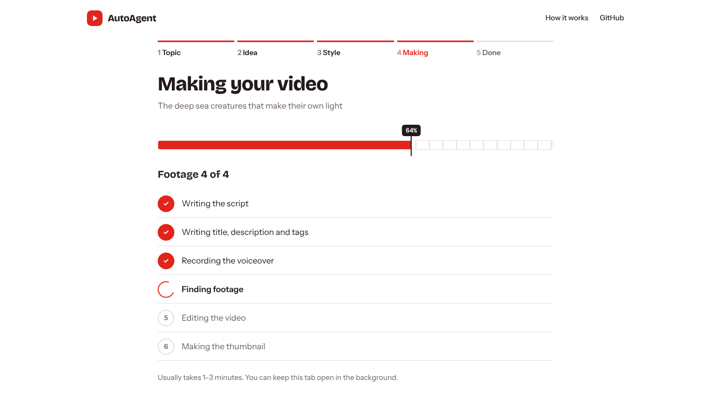

# AutoAgent

**Type a topic. Get a finished, narrated YouTube video, plus its thumbnail, title, description and tags.**

AutoAgent is a pipeline of small AI agents for faceless YouTube channels. One agent finds ideas, one writes the script, one records the voiceover, one finds stock footage, one edits the video and one prepares everything you need to upload it. It runs in the browser, so anyone with the link can use it.



## What you get

- **An MP4 video**: 45 or 90 seconds, in 16:9 or 9:16 (Shorts), with a natural-sounding voiceover, matching stock footage for each scene and captions timed to the speech.
- **A 1280×720 thumbnail** with big, readable text.
- **Upload details**: a title, description, tags and hashtags, checked against YouTube best practice, each with a copy button.



## How it works



A few decisions worth knowing about:

- **Captions are timed exactly.** Each scene's voiceover is recorded separately and measured, so every caption is on screen precisely while it's spoken.
- **No ImageMagick and no separate ffmpeg install.** Captions are drawn with Pillow, and ffmpeg comes bundled with the `imageio-ffmpeg` package.
- **Fails loudly, not silently.** If the AI service is down, you get a clear message instead of an empty video. If the neural voice is unavailable, it falls back to a standard voice and the result says so.
- **Built for strangers to use.** There's a per-visitor hourly limit, a queue cap and input validation, and finished files are deleted after 2 hours.



## Run it on your computer

You need Python 3.11 or newer.

```bash
git clone https://github.com/MuntahaJabbar12/autoagent.git
cd autoagent
python -m venv .venv
.venv\Scripts\activate          # Mac/Linux: source .venv/bin/activate
pip install -r requirements.txt
copy .env.example .env          # Mac/Linux: cp .env.example .env
```

Open `.env` and add two free keys:

| Key | Where to get it | Needed? |
|---|---|---|
| `GROQ_API_KEY` | [console.groq.com/keys](https://console.groq.com/keys) | Yes |
| `PEXELS_API_KEY` | [pexels.com/api](https://www.pexels.com/api/) | Yes |
| `YOUTUBE_API_KEY` | Google Cloud → enable *YouTube Data API v3* → Credentials | Optional, shows trending titles |

Then start it:

```bash
python -m app
```

It opens at http://localhost:8000.

## Put it online for free (Hugging Face Spaces)

1. Create an account at [huggingface.co](https://huggingface.co), then go to **New → Space**.
2. Name it `autoagent`, choose **Docker** as the SDK and the **Blank** template, and set it to **Public**.
3. In the Space, open **Files → Add file → Upload files** and upload the `app` folder, the `static` folder, `Dockerfile` and `requirements.txt`. Keep the README that Hugging Face created.
4. Open **Settings → Variables and secrets** and add `GROQ_API_KEY` and `PEXELS_API_KEY` as **secrets**, plus `YOUTUBE_API_KEY` if you have one.
5. Hugging Face builds it automatically in a few minutes. Your app is live at `https://huggingface.co/spaces/<your-name>/autoagent`.

The same Dockerfile works on Render, Railway or Fly.io.

## Tests

```bash
pip install -r requirements-dev.txt
pytest
```

42 tests. They render real videos with ffmpeg, but every outside service (AI, voice, Pexels) is replaced with a fake, so they run offline in about 10 seconds. They cover:

- **Script cleaning**: stage directions like `Narrator:` or `[music]` never reach the captions
- **Video timing**: every scene is exactly as long as its voiceover, and clips are looped when they're too short
- **Formats**: Shorts really come out at 1080×1920
- **Thumbnails**: text never ends on a dangling word like "their"
- **SEO**: tags fit YouTube's 500-character limit, and the score reflects real checks
- **Safety**: path traversal on downloads, per-visitor rate limits, invalid options fall back to safe defaults
- **Jobs**: failed jobs report a readable reason and leave no files behind, and old files are cleaned up

Tests run automatically on every push through GitHub Actions.

## Configuration

| Variable | Default | What it does |
|---|---|---|
| `GROQ_MODEL` | `openai/gpt-oss-20b` | Any chat model on Groq |
| `MAX_VIDEOS_PER_HOUR` | `4` | Per visitor |
| `MAX_QUEUE` | `6` | Videos waiting or in progress at once |
| `WORKERS` | `1` | Videos made in parallel |
| `KEEP_MINUTES` | `120` | When finished files are deleted |

## Known limitations

- Facts in scripts come from a language model. Check anything important before you publish.
- Footage is matched by keyword search, so a scene can sometimes get a loosely related clip.
- Jobs are kept in memory, so restarting the server clears the queue. That's fine for one server, but it would need Redis or similar to scale to several.
- Uploading straight to YouTube isn't included in the web version, because it needs each user to sign in with Google through a verified app. Download the files and upload them in YouTube Studio.

## Credits

Footage and photos: [Pexels](https://www.pexels.com) (free to use; contributors are credited in each video's description automatically). Voices: Microsoft Edge neural text-to-speech via [edge-tts](https://github.com/rany2/edge-tts), with [gTTS](https://github.com/pndurette/gTTS) as a fallback. Fonts: Anton and Inter (SIL Open Font License).

Built by [Muntaha Jabbar](https://github.com/MuntahaJabbar12). MIT licensed.
